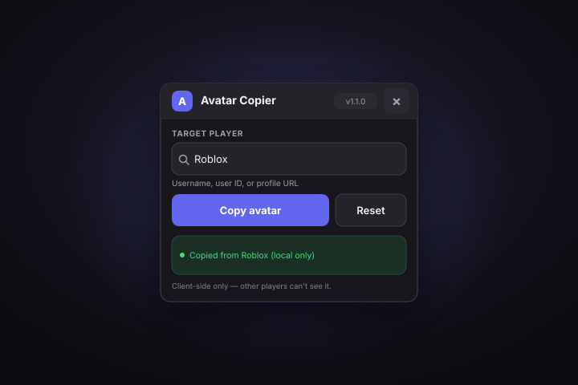
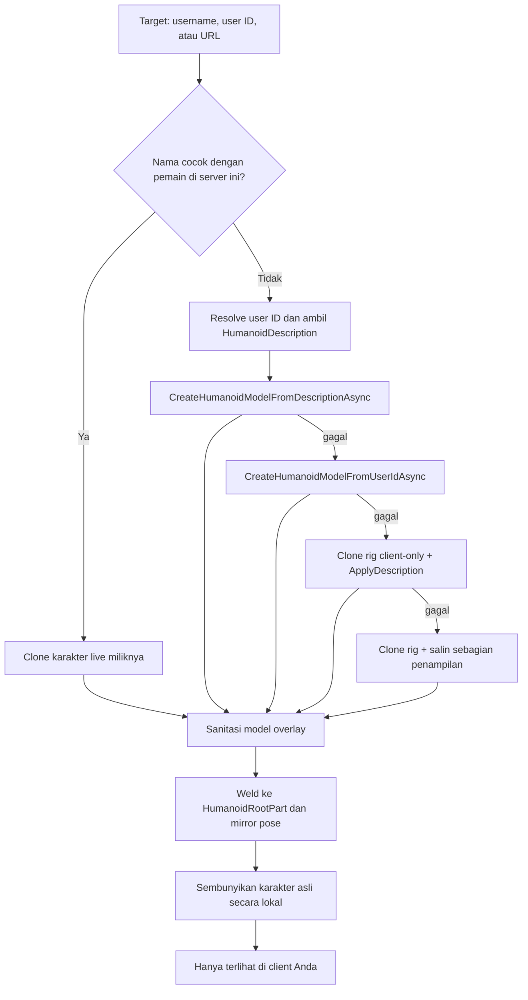

# Avatar Copier

> Pratinjau avatar Roblox siapa pun di karakter Anda sendiri — **sepenuhnya client-side**.

[English](README.md) · [Bahasa Indonesia](README.id.md)




---

## Kenapa Avatar Copier

Masukkan **username**, **user ID**, atau **URL profil Roblox** ke jendela kecil yang bisa digeser, lalu tekan **Copy avatar**. Avatar Copier membangun avatar tersebut sebagai **rig pratinjau khusus client**, menyembunyikan karakter asli Anda di layar, dan membuat pratinjau mengikuti gerakan serta pose Anda.

Roblox tidak mereplikasi model buatan client, jadi **hanya Anda yang melihat pratinjau**. Pemain lain tetap melihat karakter normal Anda. Tidak ada state server yang diubah, tidak ada data yang dikirim ke pihak ketiga, dan tidak ada pemain lain yang terpengaruh.

## Fitur

| Fitur | Keterangan |
| --- | --- |
| Copy lewat username | Contoh: `Roblox` |
| Copy lewat user ID | Contoh: `1` |
| Copy lewat URL profil | Contoh: `https://www.roblox.com/users/1/profile` |
| Fast path dalam server | Meng-clone karakter live target jika ia ada di server yang sama untuk hasil paling akurat |
| Pratinjau overlay lokal | Rig pratinjau ber-anchored mengikuti posisi Anda (tanpa weld, tanpa gangguan fisika) dan menyalin pose |
| Kontrol window | Minimize mengecil ke title bar; close menyembunyikan GUI sementara pratinjau tetap aktif, pill melayang membukanya kembali |
| Beberapa fallback build | API description → API user ID → clone rig lokal → salin sebagian penampilan |
| Tombol Reset | Menghapus overlay dan menampilkan kembali karakter asli |
| Clear input | Satu ketukan untuk memulai ulang |
| Status card | Umpan balik berwarna untuk loading, sukses, peringatan, dan error |
| Laporan error otomatis | Error tak terduga **dan kegagalan build pratinjau** disalin ke clipboard lengkap dengan traceback |
| Jendela responsif | Otomatis mengecil di layar yang lebih kecil |
| GUI bisa digeser | Jendela gelap minimalis, tidak menghalangi layar |
| Client-side only | Tanpa perubahan server, tanpa keuntungan, tanpa request pihak ketiga |

## Mulai cepat

### Loadstring (disarankan)

```lua
loadstring(game:HttpGet("https://raw.githubusercontent.com/ArchDityaa/avatar-copier/main/src/CopyAvatar.lua"))()
```

Jika `raw.githubusercontent.com` lambat atau diblokir, gunakan mirror jsDelivr:

```lua
loadstring(game:HttpGet("https://cdn.jsdelivr.net/gh/ArchDityaa/avatar-copier@main/src/CopyAvatar.lua"))()
```

### Tempel source

1. Buka Delta Executor dan attach ke Roblox.
2. Buka [`src/CopyAvatar.lua`](src/CopyAvatar.lua) dan salin seluruh isinya.
3. Tempel ke executor dan tekan **Execute**.

Tanpa key system, tanpa file konfigurasi, dan tanpa ketergantungan asset eksternal.

## Kebutuhan

- Client Roblox (PC, atau platform apa pun yang bisa menjalankan Delta)
- [Delta Executor](https://deltaexploit.com/) atau executor apa pun yang mendukung `game:HttpGet`
- `gethui` opsional — lihat [Troubleshooting](#troubleshooting)
- `setclipboard`, `toclipboard`, atau `writeclipboard` disarankan untuk laporan error otomatis; tanpa itu, laporan dicetak ke console
- Avatar R15 disarankan (umum di game modern); lihat [Batasan](#batasan)

Rig pratinjau dibuat sepenuhnya di client Anda. Script tidak pernah memanggil `ApplyDescription` pada karakter asli; API engine tersebut dibatasi untuk backend server pada karakter milik server.

## Kompatibilitas

| Lingkungan | Status | Catatan |
| --- | --- | --- |
| Delta Executor | Didukung | Memprioritaskan `gethui` jika tersedia |
| Executor lain | Didukung | Perlu `game:HttpGet`, `getgenv`; `gethui` opsional |
| Clipboard error | Didukung | Memakai `setclipboard`, `toclipboard`, atau `writeclipboard`; fallback ke console |
| PC | Didukung | Desktop memakai urutan `gethui` → `CoreGui` → `PlayerGui` |
| Mobile | Didukung | Memprioritaskan `PlayerGui`, lebih andal di executor mobile |
| Avatar R15 | Terbaik | Dukungan description/model penuh dan mirror pose sendi |
| Avatar R6 | Sebagian | Fallback lokal dapat menyalin warna tubuh dan pakaian; sendi R6/R15 hanya cocok sebagian |
| Game dengan sistem avatar custom | Sebagian | Rig lokal mungkin tidak mereproduksi tubuh khusus game; target dalam server di-clone jika memungkinkan |
| API asset executor | Bervariasi | Jika API model/asset Roblox diblokir, script beralih ke clone rig client-only |

## Penggunaan

1. Jendela kecil berjudul **Avatar Copier** muncul di layar.
2. Masukkan username, user ID, atau URL profil.
3. Tekan **Copy avatar** (atau `Enter`).
4. Tunggu status card: `Previewing <nama> (local only)`.
5. Tekan **Reset** untuk menghapus pratinjau dan menampilkan kembali avatar Anda, atau tutup jendela dengan `×`.

Overlay mengikuti posisi Anda dan mirror pose sendi setiap frame. Script tidak menyalin script animasi custom milik target, dan overlay hanya ada di client Anda.

| Aksi | Input |
| --- | --- |
| Mulai copy | Klik **Copy avatar** atau tekan `Enter` saat input fokus |
| Kosongkan input | Klik `×` di dalam kolom input |
| Kembalikan avatar | Klik **Reset** |
| Tutup jendela | Klik `×` di title bar |

### API programatik

Script mengekspos API kecil melalui `getgenv()`:

```lua
AvatarCopier.copy("Roblox")    -- copy lewat username / ID / URL
AvatarCopier.copy(1)           -- user ID numerik
AvatarCopier.reset()           -- hapus pratinjau
AvatarCopier.destroy()         -- tutup jendela
print(AvatarCopier.version)    -- "1.4.0"
print(AvatarCopier.isPreviewing())
print(AvatarCopier.getTarget())
```

| Anggota | Keterangan |
| --- | --- |
| `AvatarCopier.copy(target)` | Mulai membangun pratinjau lokal di background. Progres dan error tampil di UI. |
| `AvatarCopier.reset()` | Menghapus overlay dan mengembalikan visibilitas karakter asli. |
| `AvatarCopier.destroy()` | Menghapus GUI dan overlay, lalu membersihkan API global. |
| `AvatarCopier.isPreviewing()` | Mengembalikan `true` saat overlay pratinjau aktif. |
| `AvatarCopier.getTarget()` | Mengembalikan `{ name, userId, source }` untuk pratinjau aktif, atau `nil`. |
| `AvatarCopier.version` | String versi saat ini (`"1.4.0"`). |

`copy` dan `reset` bersifat fire-and-forget: keduanya menjalankan task lalu langsung kembali. Baca status card untuk hasilnya.

### Laporan error otomatis

Jika terjadi error Luau tak terduga — saat startup, di handler tombol, pipeline copy/reset, atau pemanggilan API — Avatar Copier menangkapnya dan menyusun laporan ringkas:

```text
Avatar Copier v1.4.0 - error report
Time: 2026-10-25 12:34:56 UTC
Context: copy button
Error: <pesan error>
Traceback:
<stack trace>
```

Kegagalan yang ditangani juga menghasilkan laporan. Jika semua metode build pratinjau gagal, laporan memuat target, user ID hasil resolve, sumber avatar, setiap metode yang dicoba, dan error-nya:

```text
Avatar Copier v1.4.0 - error report
Time: 2026-10-25 12:34:56 UTC
Context: copy/build
Target: Roblox
Resolved user ID: 1
Avatar source: avatar_api
Attempt: CreateHumanoidModelFromDescriptionAsync: <error>
Attempt: CreateHumanoidModelFromUserIdAsync: <error>
Error: All local avatar preview methods failed.
Traceback:
<stack trace>
```

Laporan disalin ke clipboard perangkat melalui `setclipboard`, `toclipboard`, atau `writeclipboard` (mana pun yang tersedia di executor). Status card menampilkan **Error details copied to clipboard.** dan console mengonfirmasi. Ini memperbaiki kegagalan apply yang sebelumnya hanya muncul sebagai warning.

Hasil validasi seperti `Player not found` atau input kosong adalah umpan balik UI normal, bukan crash, sehingga tidak menimpa clipboard. Jika tidak ada fungsi clipboard, laporan dicetak ke console dan sebuah warning menjelaskan alasannya. Tidak ada data yang diunggah ke mana pun.

## Cara kerja



1. **Resolve target**
   - Jika target ada di server yang sama, karakter live-nya di-clone terlebih dahulu — instan, tanpa API, dan mempertahankan tubuh/aksesori khusus game.
   - Jika tidak, script me-resolve user ID lalu mengambil `HumanoidDescription`.
2. **Bangun rig pratinjau client-only**
   - Prioritas: `Players:CreateHumanoidModelFromDescriptionAsync` dengan rig type Anda.
   - Lalu: `Players:CreateHumanoidModelFromUserIdAsync`.
   - Lalu: clone karakter Anda sendiri (rig buatan client) dan terapkan description ke clone tersebut.
   - Terakhir: clone rig Anda dan salin warna tubuh, skala, pakaian, serta wajah secara langsung, ditandai sebagai pratinjau sebagian.
   - Engine hanya mengizinkan `ApplyDescription` di client untuk Humanoid yang dibuat client tersebut, jadi Humanoid karakter asli tidak pernah dipakai.
3. **Attach dan ikuti**
   - Model disanitasi (tanpa script, collision, touch, constraint mover, atau raycast), dan di-parent ke `workspace.AvatarCopierOverlay`.
   - Root part-nya **di-anchored**: tidak ada weld ke rig Anda, jadi pratinjau tidak mungkin menyuntikkan impuls ke Humanoid Anda (tidak ada lompat otomatis saat berjalan).
   - Setiap `RenderStepped`, root yang di-anchored mengikuti `HumanoidRootPart` Anda dan sendi `Motor6D` yang cocok menyalin pose saat ini.
   - Karakter asli disembunyikan secara lokal dengan `LocalTransparencyModifier` dan properti client-only terkait. `Transparency` yang direplikasi tidak diubah.
4. **Kembalikan**
   - **Reset** menghentikan loop follow, menghancurkan overlay, dan mengembalikan semua properti yang disembunyikan. Karakter asli tidak pernah diubah di server.
   - **Close** (`×`) hanya menyembunyikan window — pratinjau tetap aktif. Pill melayang kecil membuka kembali; **Minimize** mengecilkan window menjadi title bar-nya. Teardown penuh tetap tersedia dari Reset dan `AvatarCopier.destroy()`.

`Players`, `RunService`, `UserInputService`, `TweenService`, dan `CoreGui` adalah satu-satunya service yang dipakai. Tidak ada HTTP ke layanan pihak ketiga, tidak ada webhook, dan tidak ada pengumpulan data.

## Privasi dan keamanan

- **Tanpa request pihak ketiga.** Data avatar diambil dari API `Players` milik Roblox sendiri.
- **Tidak ada upload.** Tidak ada analytics, telemetri, webhook, atau server konfigurasi.
- **Laporan error tetap lokal.** Detail crash hanya ditulis ke clipboard Anda sendiri (dan console); tidak pernah dikirim ke mana pun.
- **Client-side only.** Overlay dan status karakter tersembunyi hanya ada di client Anda dan tidak pernah direplikasi.
- **Tanpa keuntungan.** Alat ini adalah pratinjau pribadi, bukan penyamaran atau exploit.
- **Open source.** Seluruh script adalah satu file Luau yang bisa dibaca.

> Penggunaan executor pihak ketiga dapat melanggar [Ketentuan Penggunaan Roblox](https://en.help.roblox.com/hc/en-us/articles/115004647846) dan berisiko pada akun Anda. Baca [DISCLAIMER.md](DISCLAIMER.md) sebelum digunakan.

## Batasan

- **Game / avatar R6** — mesh, aksesori, dan pemetaan sendi mungkin tidak cocok sempurna; warna tubuh dan pakaian biasanya berhasil.
- **Sistem avatar custom** — game dengan tubuh non-standar mungkin tidak bisa direproduksi lewat API avatar publik. Clone dalam server membantu, tetapi script game tetap dapat mengganggu.
- **Avatar privat / dimoderasi** — Roblox dapat menolak mengembalikan description atau membangun model; status card melaporkan kegagalan dan menyalin detailnya.
- **API asset executor** — sebagian executor memblokir `CreateHumanoidModelFromDescriptionAsync` atau `CreateHumanoidModelFromUserIdAsync`; fallback clone lokal membuat fitur tetap bisa dipakai, meski fidelity bisa lebih rendah.
- **Rate limit** — pencarian berulang dapat dibatasi Roblox. Script menerapkan cooldown 1,5 detik antar percobaan; jika tetap terkena limit, tunggu beberapa detik.
- **Respawn / rejoin** — overlay dihapus dan status meminta Anda copy lagi. Pratinjau tidak dipasang ulang otomatis.
- **Animasi** — overlay mirror pose sendi Anda saat ini, jadi mengikuti gerakan karakter Anda. Script tidak menyalin script animasi custom atau animation pack milik target.
- **Tampilan pemain lain** — secara desain mereka tidak pernah melihat pratinjau. Ini pratinjau pribadi, bukan penyamaran.
- **Override khusus game** — sebagian game memaksa animation pack, aturan aksesori, atau sistem karakter sendiri setelah spawn.

## Troubleshooting

| Masalah | Solusi |
| --- | --- |
| Jendela tidak muncul | Cek console: seharusnya ada `[Avatar Copier] GUI attached to <parent>`. Jika muncul `Could not attach the GUI`, pin container sebelum menjalankan: `getgenv().AVATAR_COPIER_PARENT = "PlayerGui"` (atau `"CoreGui"` / `"gethui"`). |
| Jendela muncul tetapi kosong | Itu bug v1.0.0 (panel tidak pernah di-parent ke ScreenGui). Jalankan ulang loadstring di atas untuk versi terbaru. |
| `Player not found` | Periksa ejaan, atau gunakan user ID numerik / URL profil. |
| `Could not load that avatar` | Biasanya rate limit atau avatar privat. Tunggu beberapa detik lalu coba lagi. |
| `Preview failed` | Executor mungkin memblokir API avatar/model, atau avatar privat. Status seharusnya menyebut detail disalin ke clipboard; tempel laporan itu saat meminta bantuan. |
| Karakter tidak berubah | Pastikan karakter sudah termuat sepenuhnya, lalu coba lagi. Di game R6 atau executor yang membatasi API, hasilnya bisa sebagian. |
| Pratinjau hilang setelah respawn | Overlay milik karakter sebelumnya. Copy avatar lagi. |
| Reset tidak menghapus pratinjau | Tekan **Reset** sekali lagi, atau tekan `×` di title bar lalu jalankan ulang script. `AvatarCopier.reset()` juga tersedia. |
| Karakter asli tetap tidak terlihat | Reset/destroy harus mengembalikannya. Jika script terhenti, jalankan ulang; eksekusi berikutnya memulihkan visibilitas lokal dan menghapus overlay yang tersisa. |
| Script crash / muncul error merah | Tempel isi clipboard ke laporan bug. Isinya harus memuat versi Avatar Copier, context, pesan error, dan traceback. Jika clipboard kosong, salin output console. |

## FAQ

**Apakah pemain lain melihat avatar hasil copy?**
Tidak. Pratinjau adalah model buatan client dan status karakter tersembunyi hanya ada di layar Anda.

**Apakah ini mengubah game atau pemain lain?**
Tidak. Script tidak pernah mengirim perubahan avatar ke server. Ia membangun model lokal dan sementara menyembunyikan karakter asli Anda di client sendiri.

**Kenapa script tidak lagi menerapkan description ke Humanoid saya?**
`Humanoid:ApplyDescription()` hanya bekerja di backend server untuk karakter milik server. Di client, API itu hanya diizinkan untuk Humanoid yang dibuat client, jadi Avatar Copier membangun rig lokal terpisah tanpa menyentuh Humanoid asli Anda.

**Apakah perlu key atau login akun?**
Tidak. Tidak ada key system dan tidak ada autentikasi eksternal.

**Apakah aman untuk akun saya?**
Script ini tidak menyentuh state server atau mengirim data ke mana pun, tetapi penggunaan executor pihak ketiga tetap berisiko menurut Ketentuan Penggunaan Roblox. Gunakan dengan risiko sendiri — lihat [DISCLAIMER.md](DISCLAIMER.md).

**Kenapa pratinjau hilang saat respawn?**
Karakter lama dibuat ulang, sehingga overlay dibersihkan. Copy avatar lagi.

**Apakah animasi ikut tersalin?**
Overlay mirror pose sendi Anda saat ini, jadi mengikuti animasi Anda sendiri. Script tidak menyalin script animasi custom atau animation pack target; sebagian game juga memaksa animation set sendiri.

**Bisakah copy pemain yang tidak ada di server?**
Bisa, lewat username atau user ID, selama tidak terkena rate limit Roblox dan avatar tidak privat.

## Pengembangan

Script diuji secara headless dengan tooling open source — tanpa perlu client Roblox.

| Tool | Fungsi |
| --- | --- |
| [Luau](https://github.com/luau-lang/luau) | Compiler/runtime resmi Roblox Lua. Mengompilasi script dan menjalankan mock harness. |
| [Selene](https://github.com/Kampfkarren/selene) | Analisis statis terhadap standard library Roblox plus global executor. |

```bash
./tests/run.sh
```

`tests/mock_roblox.luau` hanya mengimplementasikan permukaan API Roblox yang dipakai script (instance, signal, service, `HumanoidDescription`, `gethui`). `tests/spec.luau` memverifikasi perilaku penting:

- jendela di-parent ke `ScreenGui` (regresi v1.0.0),
- mobile attach ke `PlayerGui`, desktop memprioritaskan `gethui`,
- header, input, status card, dan clear button tersedia,
- focus ring input berubah ke warna accent dan kembali saat blur,
- `UIScale` responsif tetap dalam batas,
- jalur clone dalam server dan jalur API username,
- overlay lokal dibuat, di-anchored, diikuti tiap frame, disanitasi, dan status karakter tersembunyi dipulihkan,
- Humanoid LocalPlayer asli tidak pernah diberikan ke `ApplyDescription`,
- mirror pose melalui `Motor6D.Transform`,
- rantai fallback description/API serta clone lokal/sebagian,
- kegagalan build yang ditangani menulis laporan diagnostik ke clipboard,
- error tak terduga menyertakan context dan traceback,
- warna status dan tint card untuk sukses, peringatan, dan error,
- cooldown, user tidak dikenal, input kosong, reset, cleanup respawn, dan cleanup destroy,
- tidak ada warning pada jalur pratinjau sukses dan validasi.

Suite saat ini menjalankan `141` check per profil (mobile dan desktop).

Suite dijalankan dua kali, dengan profil mobile dan desktop. CI menjalankan script yang sama pada setiap push.

Arahkan runner ke binary lokal jika tidak ada di `PATH`:

```bash
LUAU=/path/to/luau \
LUAU_COMPILE=/path/to/luau-compile \
SELENE=/path/to/selene \
./tests/run.sh
```

### Struktur proyek

```text
src/CopyAvatar.lua      Script Roblox satu file
tests/mock_roblox.luau  Mock API Roblox minimal
tests/spec.luau         Assertion headless
tests/run.sh            Selene + luau-compile + run mobile/desktop
docs/preview.svg        Pratinjau UI untuk README
```

## Roadmap

- [x] Redesign UI dengan scaling responsif dan status card (`1.1.0`)
- [x] Laporan error otomatis ke clipboard lengkap dengan traceback (`1.2.0`)
- [x] Pratinjau overlay client-only yang tidak lagi memanggil `ApplyDescription` pada Humanoid asli (`1.3.0`)
- [x] Dokumentasi bahasa Inggris dan Indonesia
- [ ] Riwayat copy dan favorit
- [ ] Copy sebagian (pakaian saja, aksesori saja, animasi saja)
- [ ] Retry/backoff dan cache lookup
- [ ] Mode ringkas opsional

Lihat [CHANGELOG.md](CHANGELOG.md) untuk riwayat rilis.

## Disclaimer

Proyek ini disediakan untuk **penggunaan pribadi, edukasi, dan kreatif** pada client Anda sendiri. Proyek ini **tidak** mengubah server game, pemain lain, atau state game apa pun, dan tidak memberikan keuntungan.

Penggunaan executor pihak ketiga dapat melanggar [Ketentuan Penggunaan Roblox](https://en.help.roblox.com/hc/en-us/articles/115004647846) dan dapat menyebabkan tindakan pada akun. Anda menggunakan script ini **dengan risiko sendiri** dan sepenuhnya bertanggung jawab atas akun Anda.

Proyek ini **tidak berafiliasi dengan, tidak didukung oleh, dan tidak disponsori oleh** Roblox Corporation atau Delta Executor.

Baca [DISCLAIMER.md](DISCLAIMER.md) selengkapnya sebelum digunakan.

## Lisensi

[MIT](LICENSE) © 2026 ArchDityaa

## Kontribusi

Issue dan pull request diterima. Jaga perubahan tetap client-side: tidak ada bagian proyek ini yang boleh mengubah state server atau memengaruhi pemain lain.

1. Fork repository.
2. Buat perubahan di branch.
3. Jalankan `./tests/run.sh`.
4. Buka pull request dengan deskripsi singkat dan hasil test.
