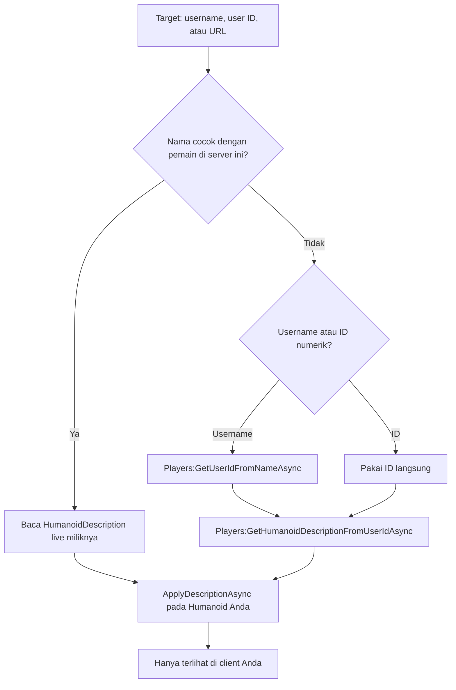

# Avatar Copier

> Pratinjau avatar Roblox siapa pun di karakter Anda sendiri — **sepenuhnya client-side**.

[English](README.md) · [Bahasa Indonesia](README.id.md)


---

## Kenapa Avatar Copier

Masukkan **username**, **user ID**, atau **URL profil Roblox** ke jendela kecil yang bisa digeser, lalu tekan **Copy avatar**. Script akan mengambil `HumanoidDescription` milik pemain tersebut dan menerapkannya ke karakter Anda secara lokal.

Roblox tidak mereplikasi perubahan penampilan karakter yang dilakukan dari client, jadi **hanya Anda yang melihat avatar baru**. Pemain lain tetap melihat tampilan normal Anda. Tidak ada state server yang diubah, tidak ada data yang dikirim ke pihak ketiga, dan tidak ada pemain lain yang terpengaruh.

## Fitur

| Fitur | Keterangan |
| --- | --- |
| Copy lewat username | Contoh: `Roblox` |
| Copy lewat user ID | Contoh: `1` |
| Copy lewat URL profil | Contoh: `https://www.roblox.com/users/1/profile` |
| Fast path dalam server | Langsung memakai description live target jika ia ada di server yang sama |
| Tombol Reset | Mengembalikan penampilan asli Anda |
| Clear input | Satu ketukan untuk memulai ulang |
| Status card | Umpan balik berwarna untuk loading, sukses, peringatan, dan error |
| Laporan error otomatis | Error Lua tak terduga disalin ke clipboard lengkap dengan traceback |
| Jendela responsif | Otomatis mengecil di layar yang lebih kecil |
| GUI bisa digeser | Jendela gelap minimalis, tidak menghalangi layar |
| Client-side only | Tanpa perubahan server, tanpa keuntungan, tanpa request pihak ketiga |

## Mulai cepat

### Loadstring (disarankan)

```lua
loadstring(game:HttpGet("https://raw.githubusercontent.com/ArchDityaa/avatar-copier/main/src/CopyAvatar.lua"))()
```

Jika `raw.githubusercontent.com` lambat atau diblokir, gunakan mirror jsDelivr:

```lua
loadstring(game:HttpGet("https://cdn.jsdelivr.net/gh/ArchDityaa/avatar-copier@main/src/CopyAvatar.lua"))()
```

### Tempel source

1. Buka Delta Executor dan attach ke Roblox.
2. Buka [`src/CopyAvatar.lua`](src/CopyAvatar.lua) dan salin seluruh isinya.
3. Tempel ke executor dan tekan **Execute**.

Tanpa key system, tanpa file konfigurasi, dan tanpa ketergantungan asset eksternal.

## Kebutuhan

- Client Roblox (PC, atau platform apa pun yang bisa menjalankan Delta)
- [Delta Executor](https://deltaexploit.com/) atau executor apa pun yang mendukung `game:HttpGet`
- `gethui` opsional — lihat [Troubleshooting](#troubleshooting)
- `setclipboard`, `toclipboard`, atau `writeclipboard` disarankan untuk laporan error otomatis; tanpa itu, laporan dicetak ke console
- Avatar R15 disarankan (umum di game modern); lihat [Batasan](#batasan)

## Kompatibilitas

| Lingkungan | Status | Catatan |
| --- | --- | --- |
| Delta Executor | Didukung | Memprioritaskan `gethui` jika tersedia |
| Executor lain | Didukung | Perlu `game:HttpGet`, `getgenv`; `gethui` opsional |
| Clipboard error | Didukung | Memakai `setclipboard`, `toclipboard`, atau `writeclipboard`; fallback ke console |
| PC | Didukung | Desktop memakai urutan `gethui` → `CoreGui` → `PlayerGui` |
| Mobile | Didukung | Memprioritaskan `PlayerGui`, lebih andal di executor mobile |
| Avatar R15 | Terbaik | Dukungan `HumanoidDescription` penuh |
| Avatar R6 | Sebagian | Warna tubuh dan pakaian biasanya berhasil; sebagian mesh dan aksesori mungkin tidak cocok |
| Game dengan sistem avatar custom | Sebagian | Game yang menimpa penampilan saat spawn dapat mengembalikan perubahan |

## Penggunaan

1. Jendela kecil berjudul **Avatar Copier** muncul di layar.
2. Masukkan username, user ID, atau URL profil.
3. Tekan **Copy avatar** (atau `Enter`).
4. Tunggu status card: `Copied from <nama> (local only)`.
5. Tekan **Reset** untuk kembali ke avatar sendiri, atau tutup jendela dengan `×`.

| Aksi | Input |
| --- | --- |
| Mulai copy | Klik **Copy avatar** atau tekan `Enter` saat input fokus |
| Kosongkan input | Klik `×` di dalam kolom input |
| Kembalikan avatar | Klik **Reset** |
| Tutup jendela | Klik `×` di title bar |

### API programatik

Script mengekspos API kecil melalui `getgenv()`:

```lua
AvatarCopier.copy("Roblox")    -- copy lewat username / ID / URL
AvatarCopier.copy(1)           -- user ID numerik
AvatarCopier.reset()           -- kembalikan penampilan asli
AvatarCopier.destroy()         -- tutup jendela
print(AvatarCopier.version)    -- "1.2.0"
```

| Anggota | Keterangan |
| --- | --- |
| `AvatarCopier.copy(target)` | Memulai copy di background. Progres dan error tampil di UI. |
| `AvatarCopier.reset()` | Mengembalikan snapshot sebelum copy pertama, atau membersihkan penampilan. |
| `AvatarCopier.destroy()` | Menghapus GUI dan membersihkan API global. |
| `AvatarCopier.version` | String versi saat ini (`"1.2.0"`). |

`copy` dan `reset` bersifat fire-and-forget: keduanya menjalankan task lalu langsung kembali. Baca status card untuk hasilnya.

### Laporan error otomatis

Jika terjadi error Luau tak terduga — saat startup, di handler tombol, pipeline copy/reset, atau pemanggilan API — Avatar Copier menangkapnya dan menyusun laporan ringkas:

```text
Avatar Copier v1.2.0 - error report
Time: 2026-10-25 12:34:56 UTC
Context: copy button
Error: <pesan error>
Traceback:
<stack trace>
```

Laporan disalin ke clipboard perangkat melalui `setclipboard`, `toclipboard`, atau `writeclipboard` (mana pun yang tersedia di executor), lalu status card berubah menjadi **Unexpected error. Details copied to clipboard.** Console juga menampilkan konfirmasi.

Hasil validasi seperti `Player not found` atau `Could not load that avatar` adalah umpan balik UI normal, bukan crash, sehingga tidak menimpa clipboard. Jika tidak ada fungsi clipboard, laporan dicetak ke console dan sebuah warning menjelaskan alasannya. Tidak ada data yang diunggah ke mana pun.

## Cara kerja



1. **Resolve target**
   - Jika target ada di server yang sama, `Humanoid:GetAppliedDescription()` miliknya langsung dipakai — instan dan tanpa API.
   - Jika tidak, script memanggil `Players:GetUserIdFromNameAsync` (untuk username) lalu `Players:GetHumanoidDescriptionFromUserIdAsync`.
2. **Terapkan secara lokal**
   - Description diterapkan ke `Humanoid` *Anda* dengan `ApplyDescriptionAsync` (dengan fallback aman ke varian lama).
   - Perubahan penampilan dari client tidak pernah direplikasi, jadi pemain lain tidak terpengaruh.
3. **Kembalikan**
   - Saat copy pertama, description asli Anda disimpan sebagai snapshot. **Reset** menerapkannya kembali.

Hanya `Players`, `UserInputService`, dan `TweenService` yang dipakai sebagai service. Tidak ada HTTP ke layanan pihak ketiga, tidak ada webhook, dan tidak ada pengumpulan data.

## Privasi dan keamanan

- **Tanpa request pihak ketiga.** Data avatar diambil dari API `Players` milik Roblox sendiri.
- **Tidak ada upload.** Tidak ada analytics, telemetri, webhook, atau server konfigurasi.
- **Laporan error tetap lokal.** Detail crash hanya ditulis ke clipboard Anda sendiri (dan console); tidak pernah dikirim ke mana pun.
- **Client-side only.** Perubahan penampilan tidak direplikasi ke server atau pemain lain.
- **Tanpa keuntungan.** Alat ini adalah pratinjau pribadi, bukan penyamaran atau exploit.
- **Open source.** Seluruh script adalah satu file Luau yang bisa dibaca.

> Penggunaan executor pihak ketiga dapat melanggar [Ketentuan Penggunaan Roblox](https://en.help.roblox.com/hc/en-us/articles/115004647846) dan berisiko pada akun Anda. Baca [DISCLAIMER.md](DISCLAIMER.md) sebelum digunakan.

## Batasan

- **Game / avatar R6** — mesh dan aksesori mungkin tidak terpetakan sempurna; warna tubuh dan pakaian biasanya berhasil.
- **Sistem avatar custom** — game yang menimpa `HumanoidDescription` saat spawn atau merender avatar dengan sistem sendiri dapat mengembalikan perubahan Anda.
- **Avatar privat / dimoderasi** — Roblox dapat menolak mengembalikan description; status card akan menampilkan bahwa avatar gagal dimuat.
- **Rate limit** — pencarian berulang dapat dibatasi Roblox. Script menerapkan cooldown 1,5 detik setelah copy berhasil; jika tetap terkena limit, tunggu beberapa detik.
- **Respawn / rejoin** — penampilan lokal kembali normal; jalankan script lagi.
- **Tampilan pemain lain** — secara desain mereka tidak pernah melihat avatar hasil copy. Ini pratinjau pribadi, bukan penyamaran.
- **Override animasi dari game** — sebagian game memaksa animation pack atau aturan aksesori sendiri setelah spawn.

## Troubleshooting

| Masalah | Solusi |
| --- | --- |
| Jendela tidak muncul | Cek console: seharusnya ada `[Avatar Copier] GUI attached to <parent>`. Jika muncul `Could not attach the GUI`, pin container sebelum menjalankan: `getgenv().AVATAR_COPIER_PARENT = "PlayerGui"` (atau `"CoreGui"` / `"gethui"`). |
| Jendela muncul tetapi kosong | Itu bug v1.0.0 (panel tidak pernah di-parent ke ScreenGui). Jalankan ulang loadstring di atas untuk versi terbaru. |
| `Player not found` | Periksa ejaan, atau gunakan user ID numerik / URL profil. |
| `Could not load that avatar` | Biasanya rate limit atau avatar privat. Tunggu beberapa detik lalu coba lagi. |
| `Failed to apply` | Setup avatar game mungkin tidak kompatibel (mis. karakter custom). Coba avatar lain atau rejoin. |
| Karakter tidak berubah | Pastikan karakter sudah termuat, lalu coba lagi. Di game R6, hasilnya bisa sebagian. |
| Avatar kembali setelah respawn | Penampilan bersifat lokal untuk karakter saat ini. Jalankan script lagi setelah respawn. |
| Reset tidak mengembalikan tampilan | Rejoin game; sebagian sistem avatar custom memblokir penerapan ulang secara lokal. |
| Script crash / muncul error merah | Tempel isi clipboard ke laporan bug. Isinya harus memuat versi Avatar Copier, context, pesan error, dan traceback. Jika clipboard kosong, salin output console. |

## FAQ

**Apakah pemain lain melihat avatar hasil copy?**
Tidak. Perubahan penampilan dari client tidak direplikasi. Hanya layar Anda yang berubah.

**Apakah ini mengubah game atau pemain lain?**
Tidak. Script hanya menerapkan `HumanoidDescription` ke `Humanoid` Anda sendiri di client.

**Apakah perlu key atau login akun?**
Tidak. Tidak ada key system dan tidak ada autentikasi eksternal.

**Apakah aman untuk akun saya?**
Script ini tidak menyentuh state server atau mengirim data ke mana pun, tetapi penggunaan executor pihak ketiga tetap berisiko menurut Ketentuan Penggunaan Roblox. Gunakan dengan risiko sendiri — lihat [DISCLAIMER.md](DISCLAIMER.md).

**Kenapa avatar kembali saat respawn?**
Karakter dibuat ulang saat respawn dan description lokal hilang. Jalankan script dan copy lagi.

**Apakah animasi ikut tersalin?**
Script menerapkan `HumanoidDescription` avatar, yang mencakup field penampilan dan animasi. Game yang memaksa animation pack sendiri dapat menimpanya.

**Bisakah copy pemain yang tidak ada di server?**
Bisa, lewat username atau user ID, selama tidak terkena rate limit Roblox dan avatar tidak privat.

## Pengembangan

Script diuji secara headless dengan tooling open source — tanpa perlu client Roblox.

| Tool | Fungsi |
| --- | --- |
| [Luau](https://github.com/luau-lang/luau) | Compiler/runtime resmi Roblox Lua. Mengompilasi script dan menjalankan mock harness. |
| [Selene](https://github.com/Kampfkarren/selene) | Analisis statis terhadap standard library Roblox plus global executor. |

```bash
./tests/run.sh
```

`tests/mock_roblox.luau` hanya mengimplementasikan permukaan API Roblox yang dipakai script (instance, signal, service, `HumanoidDescription`, `gethui`). `tests/spec.luau` memverifikasi perilaku penting:

- jendela di-parent ke `ScreenGui` (regresi v1.0.0),
- mobile attach ke `PlayerGui`, desktop memprioritaskan `gethui`,
- header, input, status card, dan clear button tersedia,
- focus ring input berubah ke warna accent dan kembali saat blur,
- `UIScale` responsif tetap dalam batas,
- fast path dalam server dan jalur API username,
- warna status dan tint card untuk sukses, peringatan, dan error,
- cooldown, user tidak dikenal, input kosong, reset, dan cleanup,
- tidak ada warning pada happy path.

Suite dijalankan dua kali, dengan profil mobile dan desktop. CI menjalankan script yang sama pada setiap push.

Arahkan runner ke binary lokal jika tidak ada di `PATH`:

```bash
LUAU=/path/to/luau \
LUAU_COMPILE=/path/to/luau-compile \
SELENE=/path/to/selene \
./tests/run.sh
```

### Struktur proyek

```text
src/CopyAvatar.lua      Script Roblox satu file
tests/mock_roblox.luau  Mock API Roblox minimal
tests/spec.luau         Assertion headless
tests/run.sh            Selene + luau-compile + run mobile/desktop
docs/preview.svg        Pratinjau UI untuk README
```

## Roadmap

- [x] Redesign UI dengan scaling responsif dan status card (`1.1.0`)
- [x] Laporan error otomatis ke clipboard lengkap dengan traceback (`1.2.0`)
- [x] Dokumentasi bahasa Inggris dan Indonesia
- [ ] Riwayat copy dan favorit
- [ ] Copy sebagian (pakaian saja, aksesori saja, animasi saja)
- [ ] Retry/backoff dan cache lookup
- [ ] Mode ringkas opsional

Lihat [CHANGELOG.md](CHANGELOG.md) untuk riwayat rilis.

## Disclaimer

Proyek ini disediakan untuk **penggunaan pribadi, edukasi, dan kreatif** pada client Anda sendiri. Proyek ini **tidak** mengubah server game, pemain lain, atau state game apa pun, dan tidak memberikan keuntungan.

Penggunaan executor pihak ketiga dapat melanggar [Ketentuan Penggunaan Roblox](https://en.help.roblox.com/hc/en-us/articles/115004647846) dan dapat menyebabkan tindakan pada akun. Anda menggunakan script ini **dengan risiko sendiri** dan sepenuhnya bertanggung jawab atas akun Anda.

Proyek ini **tidak berafiliasi dengan, tidak didukung oleh, dan tidak disponsori oleh** Roblox Corporation atau Delta Executor.

Baca [DISCLAIMER.md](DISCLAIMER.md) selengkapnya sebelum digunakan.

## Lisensi

[MIT](LICENSE) © 2026 ArchDityaa

## Kontribusi

Issue dan pull request diterima. Jaga perubahan tetap client-side: tidak ada bagian proyek ini yang boleh mengubah state server atau memengaruhi pemain lain.

1. Fork repository.
2. Buat perubahan di branch.
3. Jalankan `./tests/run.sh`.
4. Buka pull request dengan deskripsi singkat dan hasil test.
