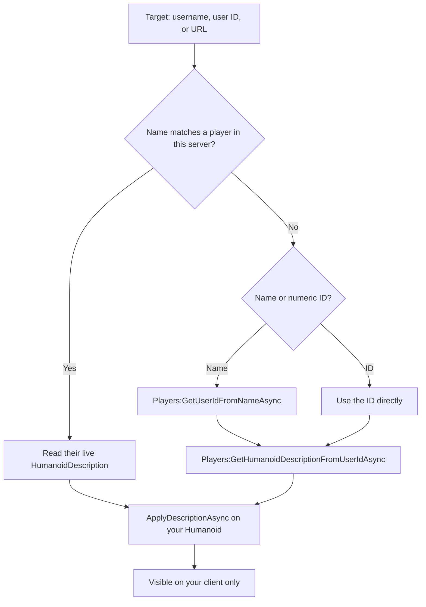

# Avatar Copier

> Preview any Roblox avatar on your own character — **client-side only**.

[English](README.md) · [Bahasa Indonesia](README.id.md)


---

## Why Avatar Copier

Type a **username**, **user ID**, or **Roblox profile URL** into a small draggable window and press **Copy avatar**. The script fetches that player's `HumanoidDescription` and applies it to your own character locally.

Roblox does not replicate character appearance changes made from the client, so **only you see the new avatar**. Other players still see your normal look. No server state is touched, nothing is sent to a third party, and no player is affected.

## Features

| Feature | Notes |
| --- | --- |
| Copy by username | e.g. `Roblox` |
| Copy by user ID | e.g. `1` |
| Copy by profile URL | e.g. `https://www.roblox.com/users/1/profile` |
| In-server fast path | Instantly reuses the target's live description when they are in the same server |
| Reset button | Restores your original appearance |
| Clear input | One tap to start over |
| Status card | Colour-coded feedback for loading, success, warnings, and errors |
| Responsive window | Automatically scales down on smaller screens |
| Draggable GUI | Minimal dark window, stays out of the way |
| Client-side only | No server changes, no advantage, no third-party requests |

## Quick start

### Loadstring (recommended)

```lua
loadstring(game:HttpGet("https://raw.githubusercontent.com/ArchDityaa/avatar-copier/main/src/CopyAvatar.lua"))()
```

If `raw.githubusercontent.com` is slow or blocked, use the jsDelivr mirror:

```lua
loadstring(game:HttpGet("https://cdn.jsdelivr.net/gh/ArchDityaa/avatar-copier@main/src/CopyAvatar.lua"))()
```

### Paste the source

1. Open Delta Executor and attach it to Roblox.
2. Open [`src/CopyAvatar.lua`](src/CopyAvatar.lua) and copy the whole file.
3. Paste it into the executor and press **Execute**.

No key system, no configuration file, and no external asset dependency.

## Requirements

- Roblox client (PC, or any platform where Delta runs)
- [Delta Executor](https://deltaexploit.com/) or any executor with `game:HttpGet`
- `gethui` is optional — see [Troubleshooting](#troubleshooting)
- An R15 avatar is recommended (most modern games); see [Limitations](#limitations)

## Compatibility

| Environment | Status | Notes |
| --- | --- | --- |
| Delta Executor | Supported | Prefers `gethui` when available |
| Other executors | Supported | Requires `game:HttpGet`, `getgenv`; `gethui` optional |
| PC | Supported | Desktop attaches to `gethui` → `CoreGui` → `PlayerGui` |
| Mobile | Supported | Attaches to `PlayerGui` first, where mobile executors are more reliable |
| R15 avatars | Best | Full `HumanoidDescription` support |
| R6 avatars | Partial | Body colours and clothing usually apply; some meshes and accessories may not map |
| Custom avatar games | Partial | Games that overwrite appearance on spawn may revert your change |

## Usage

1. A small window titled **Avatar Copier** appears on screen.
2. Enter a username, user ID, or profile URL.
3. Press **Copy avatar** (or hit `Enter`).
4. Wait for the status card: `Copied from <name> (local only)`.
5. Press **Reset** to go back to your own avatar, or close the window with `×`.

| Action | Input |
| --- | --- |
| Start a copy | Click **Copy avatar** or press `Enter` while the input is focused |
| Clear the input | Click the `×` inside the input field |
| Restore your avatar | Click **Reset** |
| Close the window | Click `×` in the title bar |

### Programmatic API

The script exposes a small API through `getgenv()`:

```lua
AvatarCopier.copy("Roblox")    -- copy by username / ID / URL
AvatarCopier.copy(1)           -- numeric user ID
AvatarCopier.reset()           -- restore your original look
AvatarCopier.destroy()         -- close the window
print(AvatarCopier.version)    -- "1.1.0"
```

| Member | Description |
| --- | --- |
| `AvatarCopier.copy(target)` | Starts a copy in the background. Progress and errors appear in the UI. |
| `AvatarCopier.reset()` | Restores the snapshot taken before your first copy, or clears the appearance. |
| `AvatarCopier.destroy()` | Removes the GUI and clears the global API. |
| `AvatarCopier.version` | Current version string (`"1.1.0"`). |

`copy` and `reset` are fire-and-forget: they spawn a task and return immediately. Read the status card for the result.

## How it works



1. **Resolve the target**
   - If the user is in the same server, their live `Humanoid:GetAppliedDescription()` is reused — instant and API-free.
   - Otherwise the script calls `Players:GetUserIdFromNameAsync` (for usernames) and then `Players:GetHumanoidDescriptionFromUserIdAsync`.
2. **Apply locally**
   - The description is applied to *your* `Humanoid` with `ApplyDescriptionAsync` (with safe fallbacks to older variants).
   - Client-side appearance changes are never replicated, so other players are unaffected.
3. **Restore**
   - The first time you copy, your original description is snapshotted. **Reset** re-applies it.

Only `Players`, `UserInputService`, and `TweenService` are used as services. There is no HTTP call to any third-party service, no webhook, and no data collection.

## Privacy and safety

- **No third-party requests.** Avatar data comes from Roblox's own `Players` API.
- **Nothing is uploaded.** There is no analytics, telemetry, webhook, or config server.
- **Client-side only.** Appearance changes are not replicated to the server or other players.
- **No advantage.** The tool is a personal preview, not a disguise or exploit.
- **Open source.** The entire script is one readable Luau file.

> Using third-party executors may violate the [Roblox Terms of Use](https://en.help.roblox.com/hc/en-us/articles/115004647846) and can lead to account action. Read the full [DISCLAIMER.md](DISCLAIMER.md) before use.

## Limitations

- **R6 games / R6 avatars** — mesh and accessory parts may not map perfectly; body colours and clothing usually do.
- **Custom avatar systems** — games that overwrite `HumanoidDescription` on spawn or render avatars through their own system may revert your change.
- **Private / moderated avatars** — Roblox may refuse to return a description; the status card will say the avatar could not be loaded.
- **Rate limits** — repeated lookups can be throttled by Roblox. The script enforces a 1.5-second cooldown after a successful copy; if you still get throttled, wait a few seconds.
- **Respawn / rejoin** — local appearance resets, just run the script again.
- **Other players' view** — by design, they never see the copied avatar. This tool is a personal preview, not a disguise.
- **Game-specific animation overrides** — some games force their own animation packs or accessory rules after spawn.

## Troubleshooting

| Problem | Fix |
| --- | --- |
| Window does not appear | Check the console: it should print `[Avatar Copier] GUI attached to <parent>`. If it says `Could not attach the GUI`, pin a container before running: `getgenv().AVATAR_COPIER_PARENT = "PlayerGui"` (or `"CoreGui"` / `"gethui"`). |
| Window appears but is empty | That was a v1.0.0 bug (the panel was never parented to the ScreenGui). Rerun the loadstring above to get the current version. |
| `Player not found` | Check the exact spelling, or use the numeric user ID / profile URL. |
| `Could not load that avatar` | Usually a rate limit or a private avatar. Wait a few seconds and retry. |
| `Failed to apply` | The game's avatar setup may be incompatible (e.g. custom character). Try another avatar or rejoin. |
| Nothing changes on my character | Make sure your character is loaded, then retry. In R6 games, expect partial results. |
| Avatar reverts after respawning | Appearance is local to the current character. Run the script again after respawn. |
| Reset does not restore my look | Rejoin the game; some custom avatar systems block local re-application. |

## FAQ

**Do other players see the copied avatar?**
No. Character appearance changes from the client are not replicated. Only your screen changes.

**Does this modify the game or other players?**
No. It only applies a `HumanoidDescription` to your own `Humanoid` on your client.

**Does it need a key or an account login?**
No. There is no key system and no external authentication.

**Is it safe for my account?**
The script itself does not touch server state or send data anywhere, but using third-party executors carries risk under Roblox's Terms of Use. You use it at your own risk — see [DISCLAIMER.md](DISCLAIMER.md).

**Why does the avatar revert when I respawn?**
Your character is recreated on respawn, and the local description is lost. Run the script and copy again.

**Does it copy animations too?**
It applies the avatar's `HumanoidDescription`, which includes appearance and animation fields. Games that force their own animation packs may override them.

**Can I copy someone who is not in my server?**
Yes, by username or user ID, subject to Roblox API rate limits and avatar privacy.

## Development

The script is tested headlessly with open-source tooling — no Roblox client required.

| Tool | Purpose |
| --- | --- |
| [Luau](https://github.com/luau-lang/luau) | Official Roblox Lua compiler/runtime. Compiles the script and executes the mock harness. |
| [Selene](https://github.com/Kampfkarren/selene) | Static analysis against the Roblox standard library plus executor globals. |

```bash
./tests/run.sh
```

`tests/mock_roblox.luau` implements only the Roblox API surface this script uses (instances, signals, services, `HumanoidDescription`, `gethui`). `tests/spec.luau` asserts the behaviour that matters:

- the window is parented to the `ScreenGui` (the v1.0.0 regression),
- mobile attaches to `PlayerGui`, desktop prefers `gethui`,
- the new header, input, status card, and clear button exist,
- the input focus ring switches to the accent colour and resets on blur,
- responsive `UIScale` stays within its bounds,
- the in-server fast path and the username API path,
- status colours and card tints for success, warning, and error,
- cooldown, unknown user, empty input, reset, and cleanup,
- no warnings on the happy path.

The suite runs twice, with a mobile and a desktop profile. CI runs the same script on every push.

Point the runner at locally installed binaries if they are not on `PATH`:

```bash
LUAU=/path/to/luau \
LUAU_COMPILE=/path/to/luau-compile \
SELENE=/path/to/selene \
./tests/run.sh
```

### Project structure

```text
src/CopyAvatar.lua      Single-file Roblox script
tests/mock_roblox.luau  Minimal Roblox API mock
tests/spec.luau         Headless assertions
tests/run.sh            Selene + luau-compile + mobile/desktop runs
docs/preview.svg        UI preview used by the README
```

## Roadmap

- [x] Redesigned UI with responsive scaling and a status card (`1.1.0`)
- [x] English and Indonesian documentation
- [ ] Copy history and favourites
- [ ] Partial copies (clothing only, accessories only, animations only)
- [ ] Retry/backoff and cached lookups
- [ ] Optional compact mode

See [CHANGELOG.md](CHANGELOG.md) for release history.

## Disclaimer

This project is provided for **personal, educational, and creative use** on your own client. It does **not** modify the game server, other players, or any game state, and it grants no advantage.

Using third-party executors may violate the [Roblox Terms of Use](https://en.help.roblox.com/hc/en-us/articles/115004647846) and can lead to account action. You use this script **at your own risk** and are solely responsible for your account.

This project is **not affiliated with, endorsed by, or sponsored by** Roblox Corporation or Delta Executor.

Read the full [DISCLAIMER.md](DISCLAIMER.md) before use.

## License

[MIT](LICENSE) © 2026 ArchDityaa

## Contributing

Issues and pull requests are welcome. Keep changes client-side only: nothing in this project should ever modify server state or affect other players.

1. Fork the repository.
2. Make your change on a branch.
3. Run `./tests/run.sh`.
4. Open a pull request with a short description and test results.
