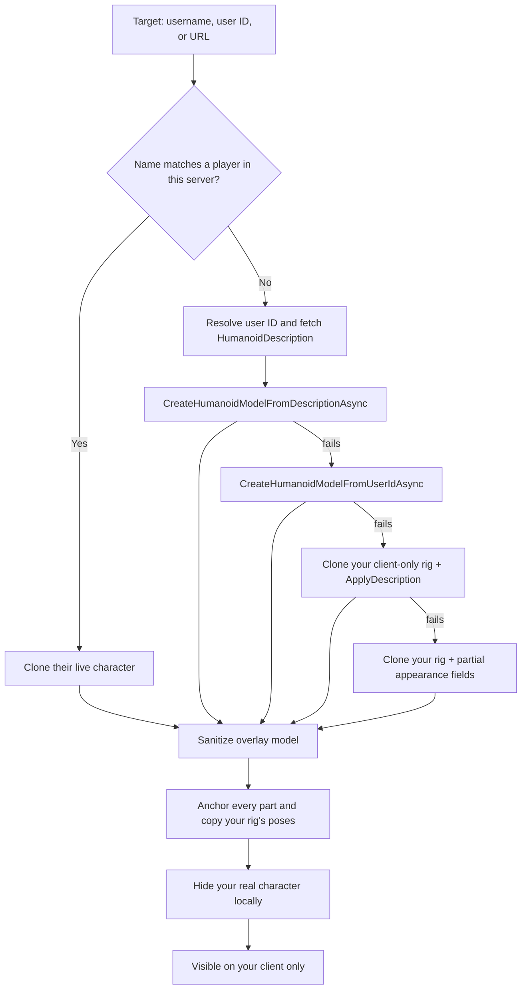

# Avatar Copier

> Preview any Roblox avatar on your own character — **client-side only**.

[English](README.md) · [Bahasa Indonesia](README.id.md)


---

## Why Avatar Copier

Type a **username**, **user ID**, or **Roblox profile URL** into a small draggable window and press **Copy avatar**. Avatar Copier builds that avatar as a **client-only preview rig**, hides your real character on your screen, and makes the preview follow your movement and pose.

Roblox does not replicate client-created models, so **only you see the preview**. Other players still see your normal character. No server state is touched, nothing is sent to a third party, and no player is affected.

## Features

| Feature | Notes |
| --- | --- |
| Copy by username | e.g. `Roblox` |
| Copy by user ID | e.g. `1` |
| Copy by profile URL | e.g. `https://www.roblox.com/users/1/profile` |
| In-server fast path | Clones the target's live character when they are in the same server for the highest fidelity |
| Local overlay preview | Anchored puppet rig: every part copies its position from your real character every frame — no welds, no joints, no physics interference, and never the target's animations |
| Window controls | Minimize collapses to the title bar; close hides the GUI while the preview stays, a floating pill reopens it |
| Multiple build fallbacks | Description API → user-ID API → local-rig clone → partial appearance copy |
| Reset button | Removes the overlay and reveals your real character again |
| Clear input | One tap to start over |
| Status card | Colour-coded feedback for loading, success, warnings, and errors |
| Automatic error reports | Unexpected errors **and failed preview attempts** are copied to your clipboard with a full traceback |
| Responsive window | Automatically scales down on smaller screens |
| Draggable GUI | Minimal dark window, stays out of the way |
| Client-side only | No server changes, no advantage, no third-party requests |

## Quick start

### Loadstring (recommended)

```lua
loadstring(game:HttpGet("https://raw.githubusercontent.com/ArchDityaa/avatar-copier/main/src/CopyAvatar.lua"))()
```

If `raw.githubusercontent.com` is slow or blocked, use the jsDelivr mirror:

```lua
loadstring(game:HttpGet("https://cdn.jsdelivr.net/gh/ArchDityaa/avatar-copier@main/src/CopyAvatar.lua"))()
```

### Paste the source

1. Open Delta Executor and attach it to Roblox.
2. Open [`src/CopyAvatar.lua`](src/CopyAvatar.lua) and copy the whole file.
3. Paste it into the executor and press **Execute**.

No key system, no configuration file, and no external asset dependency.

## Requirements

- Roblox client (PC, or any platform where Delta runs)
- [Delta Executor](https://deltaexploit.com/) or any executor with `game:HttpGet`
- `gethui` is optional — see [Troubleshooting](#troubleshooting)
- `setclipboard`, `toclipboard`, or `writeclipboard` is recommended for automatic error reports; without one, reports are printed to the console
- An R15 avatar is recommended (most modern games); see [Limitations](#limitations)

The preview rig is created entirely on your client. The script never calls `ApplyDescription` on your real character; that engine API is restricted to the backend server for server-owned characters.

## Compatibility

| Environment | Status | Notes |
| --- | --- | --- |
| Delta Executor | Supported | Prefers `gethui` when available |
| Other executors | Supported | Requires `game:HttpGet`, `getgenv`; `gethui` optional |
| Error clipboard | Supported | Uses `setclipboard`, `toclipboard`, or `writeclipboard`; falls back to the console |
| PC | Supported | Desktop attaches to `gethui` → `CoreGui` → `PlayerGui` |
| Mobile | Supported | Attaches to `PlayerGui` first, where mobile executors are more reliable |
| R15 avatars | Best | Full description/model support; every body part is mirrored frame-by-frame |
| R6 avatars | Partial | The local fallback can copy body colours and clothing; R6/R15 joints only partially match |
| Custom avatar games | Partial | A local rig may not reproduce game-specific bodies; in-server targets are cloned when possible |
| Executor asset APIs | Varies | If Roblox asset/model APIs are blocked, the script falls back to cloning your client-only rig |

## Usage

1. A small window titled **Avatar Copier** appears on screen.
2. Enter a username, user ID, or profile URL.
3. Press **Copy avatar** (or hit `Enter`).
4. Wait for the status card: `Previewing <name> (local only)`.
5. Press **Reset** to remove the preview and reveal your own avatar, or close the window with `×`.

The overlay is an **anchored puppet**: every part copies its CFrame from your character each frame, so your pose and animations are reproduced exactly. It never runs the target's animation machinery, and it exists only on your client.

| Action | Input |
| --- | --- |
| Start a copy | Click **Copy avatar** or press `Enter` while the input is focused |
| Clear the input | Click the `×` inside the input field |
| Restore your avatar | Click **Reset** |
| Close the window | Click `×` in the title bar |

### Programmatic API

The script exposes a small API through `getgenv()`:

```lua
AvatarCopier.copy("Roblox")    -- copy by username / ID / URL
AvatarCopier.copy(1)           -- numeric user ID
AvatarCopier.reset()           -- remove the preview
AvatarCopier.destroy()         -- close the window
print(AvatarCopier.version)    -- "1.6.0"
print(AvatarCopier.isPreviewing())
print(AvatarCopier.getTarget())
```

| Member | Description |
| --- | --- |
| `AvatarCopier.copy(target)` | Starts building a local preview in the background. Progress and errors appear in the UI. |
| `AvatarCopier.reset()` | Removes the overlay and restores your real character's visibility. |
| `AvatarCopier.destroy()` | Removes the GUI and overlay, then clears the global API. |
| `AvatarCopier.isPreviewing()` | Returns `true` while a preview overlay is active. |
| `AvatarCopier.getTarget()` | Returns `{ name, userId, source }` for the active preview, or `nil`. |
| `AvatarCopier.version` | Current version string (`"1.6.0"`). |

`copy` and `reset` are fire-and-forget: they spawn a task and return immediately. Read the status card for the result.

### Automatic error reports

If an unexpected Luau error happens — during startup, a button handler, the copy/reset pipeline, or an API call — Avatar Copier catches it and builds a compact report:

```text
Avatar Copier v1.6.0 - error report
Time: 2026-10-25 12:34:56 UTC
Context: copy button
Error: <error message>
Traceback:
<stack trace>
```

Handled failures also produce a report. If every preview-build method fails, the report includes the target, resolved user ID, avatar source, each attempted method, and its error:

```text
Avatar Copier v1.6.0 - error report
Time: 2026-10-25 12:34:56 UTC
Context: copy/build
Target: Roblox
Resolved user ID: 1
Avatar source: avatar_api
Attempt: CreateHumanoidModelFromDescriptionAsync: <error>
Attempt: CreateHumanoidModelFromUserIdAsync: <error>
Error: All local avatar preview methods failed.
Traceback:
<stack trace>
```

Reports are copied to your device clipboard through `setclipboard`, `toclipboard`, or `writeclipboard` (whichever the executor provides). The status card says **Error details copied to clipboard.** and the console confirms the copy. This is the fix for apply failures that previously only appeared as a warning.

Validation results such as `Player not found` or an empty input are normal UI feedback, not crashes, so they do not overwrite your clipboard. If no clipboard function is available, the report is printed to the console and a warning explains why it could not be copied. Nothing is uploaded anywhere.

## How it works



1. **Resolve the target**
   - If the user is in the same server, their live character is cloned first — instant, API-free, and preserves game-specific bodies and accessories.
   - Otherwise the script resolves the user ID, then fetches a `HumanoidDescription`.
2. **Build a client-only preview rig**
   - Preferred: `Players:CreateHumanoidModelFromDescriptionAsync` using your rig type.
   - Then: `Players:CreateHumanoidModelFromUserIdAsync`.
   - Then: clone your own character (a client-created rig) and apply the description to the clone.
   - Last: clone your rig and copy body colours, scale, clothing, and face directly, labelled as a partial preview.
   - The engine only allows `ApplyDescription` on the client for Humanoids created by that client, so the real character's Humanoid is never used.
3. **Attach and follow**
   - The model is sanitized (no scripts, collisions, touches, constraint movers, or raycast hits) and parented under `workspace.AvatarCopierOverlay`.
   - Its root part is **anchored**: nothing is welded to your rig, so the preview can never inject impulses into your Humanoid (no auto-jumping while walking).
   - Every `RenderStepped`, each preview part copies the CFrame of its matching part on your real character (the pose is reproduced exactly, with no animators or joints), and the hidden state of your real character is re-applied so camera zooms cannot undo it.
   - The target's `Animator`, joints, and any animation machinery are destroyed during sanitizing, so a preview can never run the target's animations.
   - Your real character is hidden locally with `LocalTransparencyModifier` and related client-only properties. Replicated `Transparency` is not changed.
4. **Restore**
   - **Reset** stops the follow loop, destroys the overlay, and restores every hidden property. Your real character was never modified on the server.
   - **Close** (`×`) only hides the window — the preview stays active. A small floating pill reopens it; **Minimize** collapses the window to its title bar. Full teardown remains available from Reset and `AvatarCopier.destroy()`.

`Players`, `RunService`, `UserInputService`, `TweenService`, and `CoreGui` are the only services used. There is no HTTP call to any third-party service, no webhook, and no data collection.

## Privacy and safety

- **No third-party requests.** Avatar data comes from Roblox's own `Players` API.
- **Nothing is uploaded.** There is no analytics, telemetry, webhook, or config server.
- **Error reports stay local.** Crash details are written only to your own clipboard (and the console); they are never transmitted.
- **Client-side only.** The overlay and the hidden-character state exist only on your client and are never replicated.
- **No advantage.** The tool is a personal preview, not a disguise or exploit.
- **Open source.** The entire script is one readable Luau file.

> Using third-party executors may violate the [Roblox Terms of Use](https://en.help.roblox.com/hc/en-us/articles/115004647846) and can lead to account action. Read the full [DISCLAIMER.md](DISCLAIMER.md) before use.

## Limitations

- **R6 games / R6 avatars** — mesh, accessory, and joint mappings may not match perfectly; body colours and clothing usually do.
- **Custom avatar systems** — games with non-standard bodies may not be reproducible through the public avatar APIs. In-server cloning helps, but game scripts can still interfere.
- **Private / moderated avatars** — Roblox may refuse to return a description or build a model; the status card reports the failure and copies the details.
- **Executor asset APIs** — some executors block `CreateHumanoidModelFromDescriptionAsync` or `CreateHumanoidModelFromUserIdAsync`; the local clone fallbacks keep the feature usable, though fidelity can be lower.
- **Rate limits** — repeated lookups can be throttled by Roblox. The script enforces a 1.5-second cooldown between attempts; if you still get throttled, wait a few seconds.
- **Respawn / rejoin** — the preview re-applies itself automatically on your new character (v1.6.0). A manual Reset ends the preview and also cancels the auto re-apply.
- **Animations** — the preview is an anchored puppet: every part copies your character's position each frame, so your animations follow automatically. The target's animations are never copied. Non-standard rigs fall back to ordered part pairing, so the preview still moves.
- **Other players' view** — by design, they never see the preview. This tool is a personal preview, not a disguise.
- **Game-specific overrides** — some games force their own animation packs, accessory rules, or character systems after spawn.

## Troubleshooting

| Problem | Fix |
| --- | --- |
| Window does not appear | Check the console: it should print `[Avatar Copier] GUI attached to <parent>`. If it says `Could not attach the GUI`, pin a container before running: `getgenv().AVATAR_COPIER_PARENT = "PlayerGui"` (or `"CoreGui"` / `"gethui"`). |
| Window appears but is empty | That was a v1.0.0 bug (the panel was never parented to the ScreenGui). Rerun the loadstring above to get the current version. |
| `Player not found` | Check the exact spelling, or use the numeric user ID / profile URL. |
| `Could not load that avatar` | Usually a rate limit or a private avatar. Wait a few seconds and retry. |
| `Preview failed` | The executor may block the avatar/model APIs, or the avatar may be private. The status should say details were copied to the clipboard; paste that report when asking for help. |
| Nothing changes on my character | Make sure your character is fully loaded, then retry. In R6 games or locked-down executors, expect partial results. |
| Preview disappears after respawning | Since v1.6.0 it re-applies itself automatically. If the target can no longer be resolved (left the server, private avatar), the status card explains why — copy the avatar again. |
| Reset does not remove the preview | Press **Reset** once more, or press the title-bar `×` and rerun the script. `AvatarCopier.reset()` is also available. |
| My real character stays invisible | Reset/destroy should restore it. If the script was interrupted, rerun it; the next execution restores local visibility and removes stale overlays. |
| The script crashes / shows a red error | Paste your clipboard into the bug report. It should contain the Avatar Copier version, context, error message, and traceback. If the clipboard is empty, copy the console output instead. |

## FAQ

**Do other players see the copied avatar?**
No. The preview is a client-created model and the hidden-character state only exists on your screen.

**Does this modify the game or other players?**
No. It never sends avatar changes to the server. It builds a local model and temporarily hides your real character on your own client.

**Why does the script not apply the description to my Humanoid anymore?**
`Humanoid:ApplyDescription()` only works on the backend server for server-owned characters. On the client, it is allowed only for Humanoids the client created, so Avatar Copier builds a separate local rig instead of touching your real one.

**Does it need a key or an account login?**
No. There is no key system and no external authentication.

**Is it safe for my account?**
The script itself does not touch server state or send data anywhere, but using third-party executors carries risk under Roblox's Terms of Use. You use it at your own risk — see [DISCLAIMER.md](DISCLAIMER.md).

**Why does the preview disappear when I respawn?**
It does not disappear anymore: the preview is reapplied to your new character automatically (v1.6.0). If re-applying fails — the target left the server or the avatar is private — the status card says so and you can copy again.

**Does it copy animations too?**
The preview copies every part's position from your rig each frame, so it follows your animations exactly (an anchored puppet). It never runs the target's animation machinery or animation packs; some games also force their own animation set.

**Can I copy someone who is not in my server?**
Yes, by username or user ID, subject to Roblox API rate limits and avatar privacy.

## Development

The script is tested headlessly with open-source tooling — no Roblox client required.

| Tool | Purpose |
| --- | --- |
| [Luau](https://github.com/luau-lang/luau) | Official Roblox Lua compiler/runtime. Compiles the script and executes the mock harness. |
| [Selene](https://github.com/Kampfkarren/selene) | Static analysis against the Roblox standard library plus executor globals. |

```bash
./tests/run.sh
```

`tests/mock_roblox.luau` implements only the Roblox API surface this script uses (instances, signals, services, `HumanoidDescription`, `gethui`). `tests/spec.luau` asserts the behaviour that matters:

- the window is parented to the `ScreenGui` (the v1.0.0 regression),
- mobile attaches to `PlayerGui`, desktop prefers `gethui`,
- the new header, input, status card, and clear button exist,
- the input focus ring switches to the accent colour and resets on blur,
- responsive `UIScale` stays within its bounds,
- the in-server clone path and the username API path,
- the local overlay is created, anchored, follow-driven, sanitized, and hidden-character state is restored,
- the real LocalPlayer Humanoid is never passed to `ApplyDescription`,
- the preview is an anchored puppet: joints and animation machinery stripped, all parts anchored, and part CFrames mirrored from your real rig (including the camera-zoom re-hide),
- description/API and local-clone/partial fallback chains,
- handled build failures write a diagnostic report to the clipboard,
- unexpected errors include their context and traceback,
- status colours and card tints for success, warning, and error,
- cooldown, unknown user, empty input, reset, respawn auto re-apply (and its cancellation after Reset), and destroy cleanup,
- no warnings on the successful-preview and validation paths.

The suite currently runs `151` checks per profile (mobile and desktop).

The suite runs twice, with a mobile and a desktop profile. CI runs the same script on every push.

Point the runner at locally installed binaries if they are not on `PATH`:

```bash
LUAU=/path/to/luau \
LUAU_COMPILE=/path/to/luau-compile \
SELENE=/path/to/selene \
./tests/run.sh
```

### Project structure

```text
src/CopyAvatar.lua      Single-file Roblox script
tests/mock_roblox.luau  Minimal Roblox API mock
tests/spec.luau         Headless assertions
tests/run.sh            Selene + luau-compile + mobile/desktop runs
docs/preview.svg        UI preview used by the README
```

## Roadmap

- [x] Redesigned UI with responsive scaling and a status card (`1.1.0`)
- [x] Automatic clipboard error reports with tracebacks (`1.2.0`)
- [x] Client-only overlay preview that no longer calls `ApplyDescription` on the real Humanoid (`1.3.0`)
- [x] Auto-jump-free anchored preview, minimize button, non-destructive close with a floating pill (`1.4.0`)
- [x] Own-animation playback with target animation machinery stripped, plus automatic re-apply after respawn (`1.5.0`)
- [x] Anchored part-position puppet for glitch-free movement (`1.6.0`)
- [x] English and Indonesian documentation
- [ ] Copy history and favourites
- [ ] Partial copies (clothing only, accessories only, animations only)
- [ ] Retry/backoff and cached lookups
- [ ] Optional compact mode

See [CHANGELOG.md](CHANGELOG.md) for release history.

## Disclaimer

This project is provided for **personal, educational, and creative use** on your own client. It does **not** modify the game server, other players, or any game state, and it grants no advantage.

Using third-party executors may violate the [Roblox Terms of Use](https://en.help.roblox.com/hc/en-us/articles/115004647846) and can lead to account action. You use this script **at your own risk** and are solely responsible for your account.

This project is **not affiliated with, endorsed by, or sponsored by** Roblox Corporation or Delta Executor.

Read the full [DISCLAIMER.md](DISCLAIMER.md) before use.

## License

[MIT](LICENSE) © 2026 ArchDityaa

## Contributing

Issues and pull requests are welcome. Keep changes client-side only: nothing in this project should ever modify server state or affect other players.

1. Fork the repository.
2. Make your change on a branch.
3. Run `./tests/run.sh`.
4. Open a pull request with a short description and test results.
